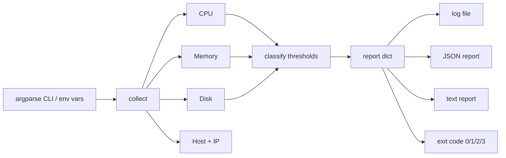

# Day 075 — DevOps Automation Project

[⬅ Day 074](../../07-devops-automation/day-074/README.md) | [📚 Phase 7: Python for DevOps Automation](../README.md) | [🏠 Home](../../README.md) | [Day 076 ➡](../../08-api-cloud/day-076/README.md)

| Phase | Difficulty | Estimated time |
|---|---|---|
| 7 — Python for DevOps Automation | 🟠 Intermediate+ | 3–4 hours |

## 1. Learning Objectives

By the end of today you will be able to:

- Build a complete **server monitoring tool** from everything learned in Phases 1–7
- Collect CPU, memory, disk, hostname and IP; log results; generate reports; handle errors
- Make it schedulable (CLI arguments, exit codes) and testable

## 2. Topic Explanation

This is your Phase 7 capstone. The complete tool is in [`server_monitor.py`](server_monitor.py) in this folder.

**Requirements (all covered):**

| Requirement | How |
|---|---|
| Check CPU usage | `psutil.cpu_percent(interval)` (fallback: load average) |
| Check memory | `psutil.virtual_memory()` |
| Check disk space | `psutil.disk_usage(path)` (fallback: `shutil.disk_usage`) |
| Collect hostname | `socket.gethostname()` |
| Collect IP address | UDP-socket trick + fallback to DNS lookup |
| Log the results | `logging` to `server_monitor.log` |
| Generate a report | JSON + text files in `reports/` |
| Handle errors | per-metric try/except, exit code 3 for monitoring failures |

**Architecture**



**Run it**
```bash
pip install psutil
python server_monitor.py
python server_monitor.py --cpu-warn 60 --disk-warn 70 --output-dir /tmp/reports
python server_monitor.py --json ; echo "exit code: $?"
```

**Schedule it** (every 5 minutes):
```bash
*/5 * * * * /opt/monitor/.venv/bin/python /opt/monitor/server_monitor.py --output-dir /var/reports >> /var/log/monitor-cron.log 2>&1
```

## 3. Syntax

```text
python server_monitor.py [--cpu-warn N] [--cpu-crit N] [--mem-warn N] [--mem-crit N]
                         [--disk-warn N] [--disk-crit N] [--disk-path PATH]
                         [--interval SECONDS] [--output-dir DIR] [--log-file FILE] [--json]
```

| Part | Meaning |
|---|---|
| `--*-warn / --*-crit` | Thresholds for each metric (CPU defaults can also come from env vars CPU_WARN/CPU_CRIT). |
| `--disk-path` | Filesystem to check. |
| `--output-dir` | Where JSON and text reports are written. |
| `--json` | Print the JSON report instead of text. |
| `exit code` | 0 OK, 1 WARNING, 2 CRITICAL, 3 monitoring error. |

## 4. Example 1 — Basic Example: Testing the tool's logic with fake metrics

```python
import argparse
import server_monitor as sm

# Replace the real metric readers with fakes - the rest of the tool runs unchanged
sm.get_hostname = lambda: "test-host"
sm.get_ip_address = lambda: "10.0.0.42"
sm.get_cpu_percent = lambda interval: 93.5
sm.get_memory = lambda: {"total_gb": 16, "used_percent": 81.0}


def broken_disk(path):
    raise PermissionError(f"cannot read {path}")


sm.get_disk = broken_disk

args = sm.parse_args(["--interval", "0"])
report = sm.collect(args)
print(sm.to_text(report).replace(report["timestamp"], "<time>").replace(report["os"], "<os>"))
print("exit code would be:", sm.STATUS_ORDER.get(report["overall"], 3))
```

## 5. Example 2 — Practical Example: Running the real tool

```python
import json
import subprocess
import sys
from pathlib import Path

result = subprocess.run(
    [sys.executable, "server_monitor.py", "--interval", "0.5", "--output-dir", "reports",
     "--log-file", "server_monitor.log"],
    capture_output=True, text=True, timeout=60,
)
print(result.stdout)
print("Exit code:", result.returncode)

latest = sorted(Path("reports").glob("*.json"))[-1]
data = json.loads(latest.read_text())
print("JSON keys:", list(data))
print("Log file lines:", len(Path("server_monitor.log").read_text().splitlines()))
```

Both examples are in [`examples.py`](examples.py). Run them with `python examples.py`.

## 6. Code Explanation

**`server_monitor.py` walkthrough**
- **Metric readers** (`get_cpu_percent`, `get_memory`, `get_disk`, `get_hostname`, `get_ip_address`) each do one thing and have fallbacks when `psutil` is missing.
- **`get_ip_address`** "connects" a UDP socket to a private address — no packet is sent, but the OS picks the outbound interface, revealing its IP.
- **`collect`** loops over `(name, reader, warning, critical)` tuples. Each reader is wrapped in `try/except`, so a broken metric is logged and recorded in `errors` while the others still run.
- **`classify`** turns values into OK/WARNING/CRITICAL; the overall status is the worst one.
- **`to_text` / `save_reports`** produce human and machine reports; filenames include the hostname and a timestamp.
- **`parse_args`** exposes every threshold on the command line (with env-var defaults for CPU).
- **`main`** returns an exit code; `sys.exit(main())` passes it to the shell, cron or CI.

**Example 1** replaces the readers with fakes (*monkeypatching*) to prove the logic: CPU 93.5 % → CRITICAL, memory 81 % → WARNING, disk error recorded, overall CRITICAL → exit code 2.

**Example 2** runs the real tool as a subprocess, shows its output and exit code, and inspects the generated JSON and log file.

## 7. Expected Output

**Example 1:**

```text
==================================================
Server Health Report - test-host (10.0.0.42)
Time: <time>   OS: <os>
==================================================
CPU       93.5%   CRITICAL (warn 75.0%, crit 90.0%)
MEMORY    81.0%   WARNING  (warn 80.0%, crit 90.0%)
ERROR   disk: cannot read /
--------------------------------------------------
OVERALL: CRITICAL
exit code would be: 2
```

**Example 2:**

```text
==================================================
Server Health Report - ip-10-0-1-25 (10.0.1.25)
Time: 2026-11-20T10:15:02+00:00   OS: Linux 6.8.0-1018-aws
==================================================
CPU        8.2%   OK       (warn 75.0%, crit 90.0%)
MEMORY    41.7%   OK       (warn 80.0%, crit 90.0%)
DISK      83.4%   WARNING  (warn 80.0%, crit 90.0%)
--------------------------------------------------
OVERALL: WARNING

Reports written: reports/health-ip-10-0-1-25-20261120-101502.json and health-ip-10-0-1-25-20261120-101502.txt

Exit code: 1
JSON keys: ['timestamp', 'hostname', 'ip_address', 'os', 'checks', 'errors', 'overall']
Log file lines: 3
```

> ℹ️ Example 2 and the tasks read live metrics; the output shown is a sample from an Ubuntu server.

## 8. Common Mistakes

**1. One failing metric crashes the run**

Monitoring must degrade gracefully — wrap each metric separately (as `collect` does).

**2. Reports with no host/time information**

Always include hostname and timestamp; reports from many servers get mixed together.

**3. Unbounded report folders**

Scheduling every 5 minutes creates 288 files a day. Add retention (Day 70) or ship results to a central system.

## 9. Practice Tasks

Full details, sample input and expected output are in [`tasks.md`](tasks.md). Solutions are kept separately in [`solutions/solution.py`](solutions/solution.py) — try first!

- **Task 1 (Easy) — Run and inspect:** Run `server_monitor.py` with `--output-dir task_reports` via subprocess, then count the JSON and TXT reports created and print the overall status from the JSON.
- **Task 2 (Medium) — Exit-code experiment:** Run the tool twice: once with absurdly low CPU thresholds (`--cpu-warn 1 --cpu-crit 2`, which will almost always be CRITICAL) and once with thresholds of 100/101 for every metric. Print both exit codes.
- **Task 3 (Practical Challenge) — Add a CSV history:** Import `server_monitor`, run `collect` once, and append one row per check (`timestamp, hostname, metric, value, status`) to `history.csv` (header only when the file is new). Print the rows and the row count. (Bonus: add this as a `--history-csv` option in the tool.)

## 10. DevOps/MLOps Connection

- **DevOps:** you now have a real, schedulable monitoring tool: cron/systemd timer on VMs, a Kubernetes CronJob or DaemonSet in clusters, or a Jenkins job.
- **Cloud:** extend it to push values to CloudWatch (`put_metric_data`) or Prometheus Pushgateway, and alert through SNS/Slack.
- **MLOps:** the same structure (collect → evaluate → report → exit code) is used for model monitoring: collect prediction latency, error rate and data drift, compare with thresholds, alert.
- Next: package this logic as **[Project 4 — Linux System Health Checker](../../projects/04-linux-system-health-checker/)**.

## 11. Interview Questions

**Q1. How would you deploy this monitor to 200 servers?**

<details><summary>Show answer</summary>

Package it (pip/Docker), deploy with Ansible or bake it into the AMI, schedule with systemd timers/cron, and ship results centrally (Prometheus, CloudWatch, ELK).

</details>

**Q2. Why should a monitoring script never crash on one failing metric?**

<details><summary>Show answer</summary>

A crash hides all other metrics and looks like 'no data'; partial results plus an explicit error are far more useful.

</details>

**Q3. How do you test code that reads live system metrics?**

<details><summary>Show answer</summary>

Separate readers from logic and replace the readers with fakes (dependency injection or monkeypatching) in tests.

</details>

## 12. Day Completion Checklist

- [ ] Understood the concept
- [ ] Practiced Example 1
- [ ] Practiced Example 2
- [ ] Completed Task 1
- [ ] Completed Task 2
- [ ] Completed Task 3
- [ ] Answered the interview questions without peeking
- [ ] Ticked Day 75 in the [main progress tracker](../../README.md#-100-day-progress-tracker)

---

[⬅ Day 074](../../07-devops-automation/day-074/README.md) | [📚 Phase 7: Python for DevOps Automation](../README.md) | [🏠 Home](../../README.md) | [Day 076 ➡](../../08-api-cloud/day-076/README.md)
