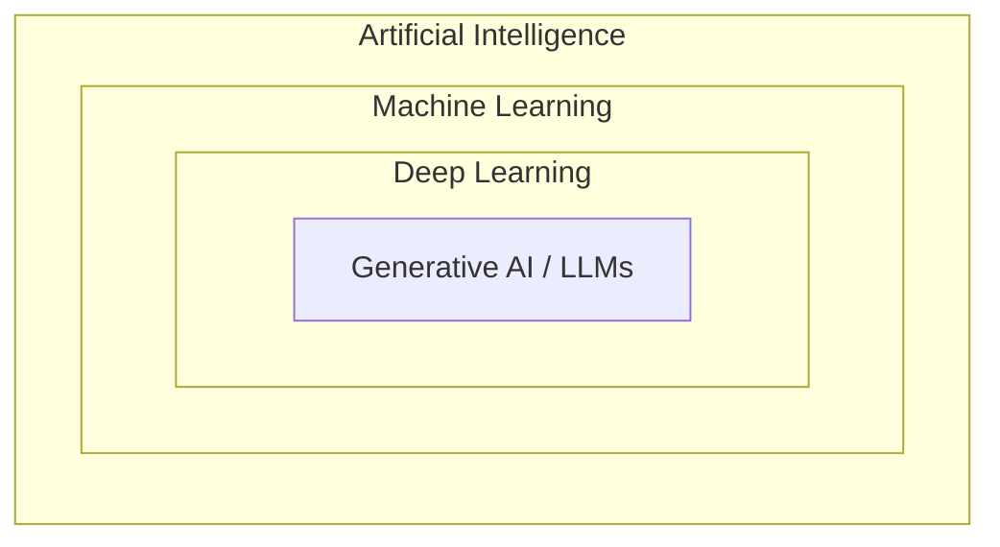

# Day 091 — AI vs ML vs Deep Learning

[⬅ Day 090](../../09-data-analysis/day-090/README.md) | [📚 Phase 10: Machine Learning Fundamentals](../README.md) | [🏠 Home](../../README.md) | [Day 092 ➡](../../10-machine-learning/day-092/README.md)

| Phase | Difficulty | Estimated time |
|---|---|---|
| 10 — Machine Learning Fundamentals | 🔴 Advanced beginner (ML) | 60–90 min |

## 1. Learning Objectives

By the end of today you will be able to:

- Explain the difference between Artificial Intelligence, Machine Learning and Deep Learning
- Contrast rule-based programming with learning from data
- Recognise where ML, deep learning and generative AI appear in DevOps and MLOps

## 2. Topic Explanation

These terms are nested circles:



- **Artificial Intelligence (AI)** — any technique that makes computers do tasks that seem "intelligent": rules engines, search, planning, ML.
- **Machine Learning (ML)** — instead of writing the rules, you give the computer **examples** (data) and it **learns** the rules (a *model*). Examples: predicting server failures, spam filters, price prediction.
- **Deep Learning (DL)** — ML using large **neural networks** with many layers. Excels at images, audio, text; needs lots of data and compute (GPUs).
- **Generative AI** — deep learning models (e.g. large language models) that *generate* text, code or images.

**Traditional programming vs ML**

```
Traditional:  rules + data  ──► answers         (you write: if cpu > 90: alert)
Machine learning: data + answers ──► rules      (the model learns when to alert)
```

When should you use ML? When the rules are too complex to write by hand, change over time, or are hidden in data (e.g. *which combination* of CPU, memory, errors and latency predicts an outage?). When simple rules work, **use simple rules** — they are cheaper, explainable and easier to operate.

Analogy: teaching a child to recognise cats. You don't give them a rulebook ("pointy ears, whiskers..."); you show many pictures labelled *cat* / *not cat*, and they learn. That's ML.

Where you'll meet it as a DevOps/MLOps engineer:
- **AIOps:** anomaly detection on metrics, log clustering, alert noise reduction, incident prediction.
- **MLOps:** deploying, scaling, monitoring and retraining models — DevOps practices applied to ML systems.

> Install the ML libraries with `pip install numpy pandas scikit-learn matplotlib`. Examples use `random_state=42` so your numbers match the expected output (tiny differences can appear across library versions). Run from inside this day's folder so `../../datasets/` resolves.

## 3. Syntax

```python
# Rule-based                      # Learned (scikit-learn style)
def predict(x):                    model = SomeModel()
    return x > THRESHOLD           model.fit(X_train, y_train)   # learn rules from data
                                   model.predict(X_new)          # apply learned rules
```

| Part | Meaning |
|---|---|
| `rule-based` | A human writes the decision logic. |
| `fit` | The model learns parameters/rules from examples. |
| `predict` | The learned model is applied to new data. |
| `model` | The learned function, saved and deployed like any other artefact. |

## 4. Example 1 — Basic Example: Rules written by a human vs rules learned from data

```python
from sklearn.tree import DecisionTreeClassifier, export_text

# Each example: [cpu_percent, error_count]  -> label: 1 = incident followed, 0 = fine
examples = [[20, 0], [35, 1], [50, 0], [60, 2], [85, 1], [92, 0], [70, 6], [88, 7], [95, 5], [40, 8]]
labels = [0, 0, 0, 0, 0, 1, 1, 1, 1, 1]


def human_rule(cpu, errors):
    """What an engineer might write first."""
    return int(cpu > 90)


human_correct = sum(human_rule(c, e) == y for (c, e), y in zip(examples, labels))
print(f"Human rule correct on {human_correct}/{len(labels)} examples")

model = DecisionTreeClassifier(max_depth=2, random_state=42)
model.fit(examples, labels)                       # the machine learns the rules
print(f"Learned model correct on {(model.predict(examples) == labels).sum()}/{len(labels)} examples")
print("Rules the model learned:")
print(export_text(model, feature_names=["cpu", "errors"]))
print("Prediction for cpu=60, errors=9:", model.predict([[60, 9]])[0])
```

## 5. Example 2 — Practical Example: A tiny neural network (the idea behind deep learning)

```python
import numpy as np
from sklearn.neural_network import MLPClassifier

rng = np.random.default_rng(42)
# A pattern that is NOT a straight line: "risky" when cpu and memory are BOTH high or BOTH low
X = rng.uniform(0, 100, size=(400, 2))
y = ((X[:, 0] > 50) == (X[:, 1] > 50)).astype(int)

net = MLPClassifier(hidden_layer_sizes=(16, 16), max_iter=2000, random_state=42)
net.fit(X / 100, y)                               # scale inputs to 0..1
print("Layers (input -> hidden -> hidden -> output):", [2, 16, 16, 1])
print("Learned weights:", sum(w.size for w in net.coefs_), "| biases:", sum(b.size for b in net.intercepts_))
print("Training accuracy:", round(net.score(X / 100, y), 3))
for point in ([90, 95], [10, 5], [90, 10]):
    print(f"cpu={point[0]:>3} mem={point[1]:>3} -> predicted risky={net.predict(np.array([point]) / 100)[0]}")
```

Both examples are in [`examples.py`](examples.py). Run them with `python examples.py`.

## 6. Code Explanation

**Example 1**
- The "human rule" only looks at CPU and misses incidents caused by many errors.
- `DecisionTreeClassifier.fit` learns rules from the labelled examples; `export_text` prints them as readable `if/else` thresholds — the model discovered that *errors* matter too.
- `predict` applies the learned rules to a new, unseen situation.

**Example 2**
- The target pattern (an XOR-like shape) cannot be separated by one straight line.
- `MLPClassifier` is a small **neural network**: 2 inputs → two hidden layers of 16 neurons → output. Training adjusts hundreds of weights automatically.
- Deep learning is the same idea at a much larger scale (millions/billions of weights, GPUs, frameworks like PyTorch).

## 7. Expected Output

**Example 1:**

```text
Human rule correct on 7/10 examples
Learned model correct on 10/10 examples
Rules the model learned:
|--- errors <= 3.50
|   |--- cpu <= 88.50
|   |   |--- class: 0
|   |--- cpu >  88.50
|   |   |--- class: 1
|--- errors >  3.50
|   |--- class: 1

Prediction for cpu=60, errors=9: 1
```

**Example 2:**

```text
Layers (input -> hidden -> hidden -> output): [2, 16, 16, 1]
Learned weights: 304 | biases: 33
Training accuracy: 0.988
cpu= 90 mem= 95 -> predicted risky=1
cpu= 10 mem=  5 -> predicted risky=1
cpu= 90 mem= 10 -> predicted risky=0
```

> ℹ️ Neural network results can differ slightly between scikit-learn versions.

## 8. Common Mistakes

**1. Using ML when a rule is enough**

If `disk > 90%` works, ship the rule. ML adds data, training, monitoring and explainability costs.

**2. Thinking AI = ChatGPT**

LLMs are one (generative, deep learning) part of AI. Most production ML is classic tabular ML like you'll build this week.

**3. Expecting magic without data**

Models only learn patterns present in good, representative, labelled data.

## 9. Practice Tasks

Full details, sample input and expected output are in [`tasks.md`](tasks.md). Solutions are kept separately in [`solutions/solution.py`](solutions/solution.py) — try first!

- **Task 1 (Easy) — Classify the technique:** For each scenario print AI-rule / ML / DL: (1) alert when disk > 90 %, (2) predict next week's traffic from history, (3) detect defects in product photos, (4) chatbot answering runbook questions, (5) cluster similar log messages.
- **Task 2 (Medium) — Rule vs model:** Using the Example 1 data, write your own better rule (using both cpu and errors) and compare its correctness with the learned tree.
- **Task 3 (Practical Challenge) — Where does ML help my pipeline?:** Create a list of dicts describing 4 DevOps problems (name, has_labels, data_volume, rules_known). Write `recommend(problem)` returning `simple rules`, `supervised ML`, `unsupervised ML` or `collect data first`, and print a recommendation table.

## 10. DevOps/MLOps Connection

- **DevOps / AIOps:** anomaly detection on Prometheus metrics, predictive autoscaling, log pattern mining, alert correlation.
- **Cloud:** managed AI services (SageMaker, Bedrock) — you'll deploy and operate them.
- **MLOps:** a model is just another artefact: versioned, tested, containerised, deployed, monitored and rolled back. You already know most of these skills from DevOps — the next days add the ML-specific parts.

## 11. Interview Questions

**Q1. What is the difference between AI, ML and deep learning?**

<details><summary>Show answer</summary>

AI is the broad field of making machines act intelligently; ML is a subset where systems learn from data; deep learning is a subset of ML using multi-layer neural networks.

</details>

**Q2. When would you NOT use machine learning?**

<details><summary>Show answer</summary>

When simple deterministic rules solve the problem, data is scarce or unlabelled, explainability is mandatory, or the cost of operating a model outweighs the benefit.

</details>

**Q3. What is MLOps?**

<details><summary>Show answer</summary>

Applying DevOps principles (automation, CI/CD, versioning, monitoring) to the ML lifecycle: data, training, deployment and monitoring of models.

</details>

## 12. Day Completion Checklist

- [ ] Understood the concept
- [ ] Practiced Example 1
- [ ] Practiced Example 2
- [ ] Completed Task 1
- [ ] Completed Task 2
- [ ] Completed Task 3
- [ ] Answered the interview questions without peeking
- [ ] Ticked Day 91 in the [main progress tracker](../../README.md#-100-day-progress-tracker)

---

[⬅ Day 090](../../09-data-analysis/day-090/README.md) | [📚 Phase 10: Machine Learning Fundamentals](../README.md) | [🏠 Home](../../README.md) | [Day 092 ➡](../../10-machine-learning/day-092/README.md)
