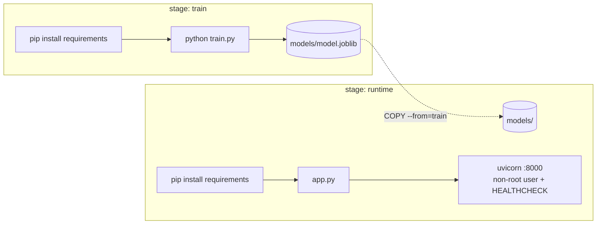

# Day 099 — Dockerizing an ML Application

[⬅ Day 098](../../11-mlops/day-098/README.md) | [📚 Phase 11: MLOps Foundation](../README.md) | [🏠 Home](../../README.md) | [Day 100 ➡](../../11-mlops/day-100/README.md)

| Phase | Difficulty | Estimated time |
|---|---|---|
| 11 — MLOps Foundation | 🔴 Advanced beginner (MLOps) | 60–90 min |

## 1. Learning Objectives

By the end of today you will be able to:

- Write a production-style Dockerfile for a Python ML API (slim base, non-root, healthcheck)
- Use a multi-stage build to train and serve with identical library versions
- Build, run, inspect and test the container; apply image best practices

## 2. Topic Explanation

You know Docker already — today you apply it to an ML service. ML images have special concerns: **big dependencies**, **model artefacts**, and **library-version compatibility** between training and serving.

**The [`Dockerfile`](Dockerfile) in this folder uses two stages:**



1. **train stage** installs the pinned requirements and trains the model → the model is created with *exactly* the scikit-learn version that will serve it (no pickle incompatibility).
2. **runtime stage** starts from a clean `python:3.12-slim`, installs the same requirements, copies only `app.py` and the trained model. Training data and build tools are **not** in the final image.

**Best practices applied**

| Practice | Why |
|---|---|
| `python:3.12-slim` base + pinned packages | smaller, reproducible images |
| `COPY requirements.txt` before code | Docker layer caching: dependencies rebuild only when requirements change |
| `PIP_NO_CACHE_DIR`, `.dockerignore` | smaller image, no secrets/venvs in the build context |
| `USER appuser` (non-root) | security: a compromised app can't own the container |
| `HEALTHCHECK` on `/health` | Docker/Compose know when the service is really ready |
| `PYTHONUNBUFFERED=1` | logs appear immediately in `docker logs` |
| config via `ENV` (`MODEL_PATH`, `LOG_LEVEL`) | same image for every environment |
| image tag = version (`:1.0.0`), never only `latest` | traceable rollbacks |

**Commands**
```bash
docker build -t server-failure-api:1.0.0 .
docker run -d --name sfa -p 8000:8000 server-failure-api:1.0.0
docker ps --filter name=sfa          # wait for "(healthy)"
curl -s localhost:8000/health
BASE_URL=http://127.0.0.1:8000 python smoke_test.py
docker logs sfa ; docker rm -f sfa
```

> Docker must be installed. The examples call `docker` through `subprocess`; if Docker isn't available they explain what to install.

## 3. Syntax

```dockerfile
FROM python:3.12-slim AS train
...
RUN python train.py --out /build/models

FROM python:3.12-slim AS runtime
COPY --from=train /build/models ./models
USER appuser
HEALTHCHECK CMD python -c "...urlopen('http://127.0.0.1:8000/health')..."
CMD ["uvicorn", "app:app", "--host", "0.0.0.0", "--port", "8000"]
```

| Part | Meaning |
|---|---|
| `FROM ... AS name` | Starts a (named) build stage. |
| `COPY --from=stage` | Copy artefacts from an earlier stage. |
| `USER` | Run as a non-root user. |
| `HEALTHCHECK` | Command Docker runs to decide if the container is healthy. |
| `CMD ["uvicorn", ...]` | Exec-form start command; `--host 0.0.0.0` makes it reachable from outside the container. |

## 4. Example 1 — Basic Example: Lint the Dockerfile with Python (a mini hadolint)

```python
from pathlib import Path

RULES = [
    ("pinned base image (no :latest)", lambda t: "FROM" in t and ":latest" not in t),
    ("slim or minimal base", lambda t: "-slim" in t or "alpine" in t or "distroless" in t),
    ("multi-stage build", lambda t: t.count("FROM ") >= 2),
    ("requirements copied before source (layer caching)",
     lambda t: t.index("COPY requirements.txt") < t.index("COPY app.py")),
    ("pip cache disabled", lambda t: "PIP_NO_CACHE_DIR=1" in t or "--no-cache-dir" in t),
    ("runs as non-root USER", lambda t: "\nUSER " in t and "USER root" not in t),
    ("HEALTHCHECK defined", lambda t: "HEALTHCHECK" in t),
    ("exec-form CMD", lambda t: 'CMD ["' in t),
    ("no secrets in ENV", lambda t: not any(w in t.upper() for w in ("PASSWORD=", "SECRET=", "AWS_SECRET"))),
]

dockerfile = Path("Dockerfile").read_text()
passed = 0
for name, check in RULES:
    ok = check(dockerfile)
    passed += ok
    print(f"[{'PASS' if ok else 'FAIL'}] {name}")
print(f"{passed}/{len(RULES)} checks passed")

ignored = [line.strip() for line in Path(".dockerignore").read_text().splitlines()
           if line.strip() and not line.startswith("#")]
print(".dockerignore excludes:", ignored)
print("Stages:", [line.split(" AS ")[1] for line in dockerfile.splitlines() if line.startswith("FROM ")])
```

## 5. Example 2 — Practical Example: Build, run and smoke-test the container from Python

```python
import shutil
import subprocess
import sys
import time

IMAGE, NAME, PORT = "server-failure-api:1.0.0", "sfa-demo", "8000"


def sh(*cmd, check=True):
    print("$", " ".join(cmd))
    result = subprocess.run(cmd, capture_output=True, text=True)
    if check and result.returncode != 0:
        raise SystemExit(result.stderr.strip())
    return result.stdout.strip()


if not shutil.which("docker"):
    sys.exit("Docker is not installed - see https://docs.docker.com/get-docker/")

sh("docker", "build", "-t", IMAGE, ".")
print(sh("docker", "image", "ls", IMAGE, "--format", "{{.Repository}}:{{.Tag}} {{.Size}}"))
sh("docker", "rm", "-f", NAME, check=False)
sh("docker", "run", "-d", "--name", NAME, "-p", f"{PORT}:8000", IMAGE)

for _ in range(30):                                   # wait for the HEALTHCHECK
    status = sh("docker", "inspect", "--format", "{{.State.Health.Status}}", NAME)
    if status == "healthy":
        break
    time.sleep(2)
print("container health:", status)
print("user inside container:", sh("docker", "exec", NAME, "whoami"))

smoke = subprocess.run([sys.executable, "smoke_test.py"], env={"BASE_URL": f"http://127.0.0.1:{PORT}", "PATH": ""},
                       capture_output=True, text=True)
print(smoke.stdout.strip())
print("last log line:", sh("docker", "logs", NAME).splitlines()[-1][-60:])
sh("docker", "rm", "-f", NAME)
print("smoke test exit code:", smoke.returncode)
```

Both examples are in [`examples.py`](examples.py). Run them with `python examples.py`.

## 6. Code Explanation

**Example 1**
- A tiny linter reads the Dockerfile and checks best practices with simple string rules — the same idea as `hadolint` or policy checks in CI.
- It also lists the build stages and the `.dockerignore` patterns.

**Example 2**
- `sh()` wraps `subprocess.run` (Day 61/71) and echoes each command like a CI log.
- Build → list image (tag and size) → run detached with a port mapping.
- Polls `docker inspect ... .State.Health.Status` until the `HEALTHCHECK` reports `healthy`.
- `docker exec whoami` proves the app runs as the non-root `appuser`.
- `smoke_test.py` hits the running container over HTTP (health, prediction, validation) and returns an exit code — the step CI uses to decide whether to push the image.
- Finally the container is removed.

## 7. Expected Output

**Example 1:**

```text
[PASS] pinned base image (no :latest)
[PASS] slim or minimal base
[PASS] multi-stage build
[PASS] requirements copied before source (layer caching)
[PASS] pip cache disabled
[PASS] runs as non-root USER
[PASS] HEALTHCHECK defined
[PASS] exec-form CMD
[PASS] no secrets in ENV
9/9 checks passed
.dockerignore excludes: ['.venv/', '__pycache__/', '*.pyc', '.pytest_cache/', '.git/', '.env', 'models/', '*.ipynb']
Stages: ['train', 'runtime']
```

**Example 2:**

```text
$ docker build -t server-failure-api:1.0.0 .
$ docker image ls server-failure-api:1.0.0 --format {{.Repository}}:{{.Tag}} {{.Size}}
server-failure-api:1.0.0 512MB
$ docker rm -f sfa-demo
$ docker run -d --name sfa-demo -p 8000:8000 server-failure-api:1.0.0
$ docker inspect --format {{.State.Health.Status}} sfa-demo
$ docker inspect --format {{.State.Health.Status}} sfa-demo
container health: healthy
$ docker exec sfa-demo whoami
user inside container: appuser
[PASS] service healthy
[PASS] predict returns 200
[PASS] risky server flagged
[PASS] invalid input rejected (422)
$ docker logs sfa-demo
last log line: model-api: POST /predict -> 422 in 1.9 ms
$ docker rm -f sfa-demo
smoke test exit code: 0
```

> ℹ️ Example 2 needs Docker and network access to pull `python:3.12-slim`; the output shown is a sample run. Image size varies by platform.

## 8. Common Mistakes

**1. Training on the host and copying the model into a different environment**

Different scikit-learn/numpy versions can break unpickling. Train in the same image (multi-stage) or pin identical versions.

**2. Binding uvicorn to 127.0.0.1 inside the container**

The service is then unreachable from outside. Use `--host 0.0.0.0` inside containers.

**3. Huge images**

Full `python:3.12` + build tools + data + caches can exceed 1.5 GB. Use slim bases, multi-stage builds and `.dockerignore`.

## 9. Practice Tasks

Full details, sample input and expected output are in [`tasks.md`](tasks.md). Solutions are kept separately in [`solutions/solution.py`](solutions/solution.py) — try first!

- **Task 1 (Easy) — Inspect the Dockerfile:** Parse `Dockerfile` and print every instruction keyword with its count (FROM, RUN, COPY, ENV, ...), plus all exposed ports and environment variables.
- **Task 2 (Medium) — Image size budget:** Write `check_image_size(size_text, budget_mb)` that converts Docker size strings (`"512MB"`, `"1.2GB"`, `"850kB"`) to MB and returns `OK`/`TOO BIG`. Test with several values and a 600 MB budget.
- **Task 3 (Practical Challenge) — Generate a Compose file:** Using PyYAML, generate `docker-compose.yml` for the API with a build context, image tag, port 8000, `LOG_LEVEL` env var, `restart: unless-stopped` and resource limits (1 CPU, 512M). Print it and the command to start it.

## 10. DevOps/MLOps Connection

- **DevOps:** this is your home turf — the image goes through the same CI (build, scan with Trivy, push to ECR/GHCR) and CD (Helm/Argo CD) pipeline as any microservice.
- **Kubernetes:** map `HEALTHCHECK` to `readinessProbe`/`livenessProbe` on `/health`, set CPU/memory requests/limits, scale with HPA on CPU or request rate.
- **MLOps:** "model + code + environment" packaged together is what makes ML deployments reproducible. Retraining = a new image tag; rollback = deploy the previous tag.

## 11. Interview Questions

**Q1. Why use a multi-stage Docker build for an ML service?**

<details><summary>Show answer</summary>

To keep build/training tools and data out of the final image (smaller, safer) and to guarantee the model is trained with the same library versions used for serving.

</details>

**Q2. Why run containers as a non-root user?**

<details><summary>Show answer</summary>

To limit the damage if the application is compromised and to satisfy security policies (e.g. Kubernetes Pod Security).

</details>

**Q3. How do you speed up Docker builds for Python apps?**

<details><summary>Show answer</summary>

Copy and install requirements before copying source code to leverage layer caching, use slim bases, disable pip cache, and use .dockerignore.

</details>

## 12. Day Completion Checklist

- [ ] Understood the concept
- [ ] Practiced Example 1
- [ ] Practiced Example 2
- [ ] Completed Task 1
- [ ] Completed Task 2
- [ ] Completed Task 3
- [ ] Answered the interview questions without peeking
- [ ] Ticked Day 99 in the [main progress tracker](../../README.md#-100-day-progress-tracker)

---

[⬅ Day 098](../../11-mlops/day-098/README.md) | [📚 Phase 11: MLOps Foundation](../README.md) | [🏠 Home](../../README.md) | [Day 100 ➡](../../11-mlops/day-100/README.md)
