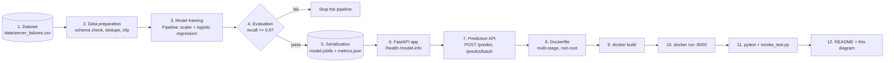

# Day 100 — End-to-End Mini MLOps Project

[⬅ Day 099](../../11-mlops/day-099/README.md) | [📚 Phase 11: MLOps Foundation](../README.md) | [🏠 Home](../../README.md)

| Phase | Difficulty | Estimated time |
|---|---|---|
| 11 — MLOps Foundation | 🔴 Advanced beginner (MLOps) | 3–5 hours |

## 1. Learning Objectives

By the end of today you will be able to:

- Deliver a complete ML system: data → prep → train → evaluate → serialize → API → Docker → tests
- Apply quality gates, versioning and reproducibility practices from DevOps to ML
- Document the system with a README and an architecture diagram, ready for GitHub

## 2. Topic Explanation

🎉 **Day 100!** You started with `print("Hello, World!")`. Today you ship a production-style ML service. The complete project lives in [`mini-mlops/`](mini-mlops/README.md).

**Problem:** predict whether a server will fail soon from its CPU, memory, disk, error count and response time, and expose the prediction as an API for the monitoring system.

**Architecture**



**Requirement checklist**

| # | Requirement | Where |
|---|---|---|
| 1 | Dataset | `mini-mlops/data/server_failures.csv` |
| 2 | Data preparation | `train.py → load_and_prepare()` |
| 3 | Model training | `train.py → train()` |
| 4 | Model evaluation | metrics + recall quality gate |
| 5 | Model serialization | `models/model.joblib`, `models/metrics.json` |
| 6 | FastAPI application | `app.py` |
| 7 | Prediction API | `POST /predict`, `POST /predict/batch` |
| 8 | Dockerfile | `Dockerfile` (+ `.dockerignore`) |
| 9 | Docker image build | `docker build -t server-failure-api:1.0.0 .` / `make docker-build` |
| 10 | Container execution | `docker run -p 8000:8000 ...` / `make docker-run` |
| 11 | Testing the API | `pytest -q` (in-process) + `smoke_test.py` (running container) |
| 12 | README documentation | `mini-mlops/README.md` |

**DevOps → MLOps mapping:** unit tests → *data validation + model quality gates*; build artefact → *model bundle*; Docker image → *model + code + environment*; health checks → *model loaded?*; monitoring → *prediction drift & accuracy decay*; release → *new model version*.

> Install: `pip install -r mini-mlops/requirements-dev.txt`. Docker is needed for steps 9–10.

## 3. Syntax

```bash
cd mini-mlops
python train.py                     # steps 1-5
pytest -q                           # step 11 (in-process)
uvicorn app:app --port 8000         # steps 6-7
docker build -t server-failure-api:1.0.0 .                       # step 9
docker run -d --name sfa -p 8000:8000 server-failure-api:1.0.0   # step 10
BASE_URL=http://127.0.0.1:8000 python smoke_test.py              # step 11 (container)
```

| Part | Meaning |
|---|---|
| `train.py` | Data prep, training, evaluation, quality gate, serialization. |
| `pytest -q` | Fast API tests without starting a server. |
| `uvicorn app:app` | Runs the API locally. |
| `docker build / run` | Package and run the service. |
| `smoke_test.py` | End-to-end checks against the running container. |

## 4. Example 1 — Basic Example: Run the training pipeline (steps 1–5)

```python
import json
import subprocess
import sys
from pathlib import Path

project = Path("mini-mlops")
result = subprocess.run([sys.executable, "train.py"], cwd=project, capture_output=True, text=True)
print(result.stdout.strip())
print("exit code:", result.returncode)

metrics = json.loads((project / "models" / "metrics.json").read_text())
print("metrics.json:", {k: metrics[k] for k in ("accuracy", "precision", "recall", "roc_auc")})

strict = subprocess.run([sys.executable, "train.py", "--min-recall", "0.99", "--out", "models_strict"],
                        cwd=project, capture_output=True, text=True)
print(strict.stdout.strip().splitlines()[-1])
print("strict gate exit code:", strict.returncode, "(CI would stop here)")
```

## 5. Example 2 — Practical Example: API tests, container build and smoke test (steps 6–11)

```python
import shutil
import subprocess
import sys

project = "mini-mlops"


def run(cmd, **kwargs):
    print("$", " ".join(cmd))
    return subprocess.run(cmd, cwd=project, capture_output=True, text=True, **kwargs)


run([sys.executable, "train.py"])
tests = run([sys.executable, "-m", "pytest", "-q", "test_app.py"])
print(tests.stdout.strip().splitlines()[-1])

if shutil.which("docker") is None:
    sys.exit("Docker not installed: skipping steps 9-10")
build = run(["docker", "build", "-t", "server-failure-api:1.0.0", "."])
print("build ok" if build.returncode == 0 else build.stderr[-500:])
run(["docker", "rm", "-f", "sfa"])
print(run(["docker", "run", "-d", "--name", "sfa", "-p", "8000:8000", "server-failure-api:1.0.0"]).stdout[:12])
smoke = run([sys.executable, "smoke_test.py"], env={"BASE_URL": "http://127.0.0.1:8000"})
print(smoke.stdout.strip())
print(run(["curl", "-s", "-X", "POST", "http://127.0.0.1:8000/predict", "-H", "Content-Type: application/json",
           "-d", '{"cpu_usage": 93, "memory_usage": 91, "disk_usage": 88, "error_count": 7, "response_time_ms": 650}']).stdout)
run(["docker", "rm", "-f", "sfa"])
```

Both examples are in [`examples.py`](examples.py). Run them with `python examples.py`.

## 6. Code Explanation

**Example 1 — the training pipeline (`train.py`)**
- `load_and_prepare` validates the schema (required columns), removes duplicates/missing rows and clips impossible percentages.
- `train` builds a **Pipeline** (scaler + logistic regression), evaluates on a stratified hold-out set at the business threshold 0.3, and reports accuracy, precision, recall, F1, ROC AUC.
- A **quality gate** (`--min-recall`) refuses to save a model that doesn't meet the bar and returns exit code 1 — exactly how CI blocks a bad release. The strict run demonstrates the gate failing.
- `save` writes the model bundle with metadata (version, data hash, library versions) and `metrics.json`.

**Example 2 — serving and shipping**
- `pytest` runs `test_app.py` against the app in-process (health, risky/calm predictions, validation, batch).
- `docker build` uses the multi-stage Dockerfile (train stage → slim runtime stage).
- The container runs on port 8000; `smoke_test.py` waits for `/health`, checks predictions and validation over real HTTP, and exits non-zero on failure.
- `curl` shows the raw API response a monitoring system would consume.

## 7. Expected Output

**Example 1:**

```text
[data] server_failures.csv: 400 rows -> 400 after cleaning, failure rate 18.5%
[eval] accuracy=0.91 precision=0.6957 recall=0.8889 f1=0.7805 roc_auc=0.981
[gate] passed: recall 0.8889 >= 0.8
[save] models/model.joblib (2.2 KB), metrics.json
exit code: 0
metrics.json: {'accuracy': 0.91, 'precision': 0.6957, 'recall': 0.8889, 'roc_auc': 0.981}
[gate] FAILED: recall 0.8889 < 0.99; model not saved
strict gate exit code: 1 (CI would stop here)
```

**Example 2:**

```text
$ /usr/bin/python3 train.py
$ /usr/bin/python3 -m pytest -q test_app.py
5 passed in 1.84s
$ docker build -t server-failure-api:1.0.0 .
build ok
$ docker rm -f sfa
$ docker run -d --name sfa -p 8000:8000 server-failure-api:1.0.0
3f9c1b7e2a4d
$ /usr/bin/python3 smoke_test.py
[PASS] service healthy
[PASS] predict returns 200
[PASS] risky server flagged
[PASS] invalid input rejected (422)
$ curl -s -X POST http://127.0.0.1:8000/predict -H Content-Type: application/json -d {"cpu_usage": 93, "memory_usage": 91, "disk_usage": 88, "error_count": 7, "response_time_ms": 650}
{"failure":true,"probability":0.9981,"threshold":0.3,"model_version":"1.0.0"}
$ docker rm -f sfa
```

> ℹ️ Example 2 needs FastAPI/pytest (and Docker for steps 9–10); the output shown is a sample run.

## 8. Common Mistakes

**1. No quality gate**

Automatically deploying every trained model eventually ships a bad one. Gate on metrics (and compare with the current production model).

**2. Untracked data**

If the training data changes silently you can't reproduce the model. Record a data hash/version (DVC, lakeFS, S3 versioning).

**3. Stopping at deployment**

Models decay as the world changes. Monitor input distributions, prediction rates and real outcomes; retrain when they drift.

## 9. Practice Tasks

Full details, sample input and expected output are in [`tasks.md`](tasks.md). Solutions are kept separately in [`solutions/solution.py`](solutions/solution.py) — try first!

- **Task 1 (Easy) — Retrain with a new threshold:** Run `train.py` with `--threshold 0.5 --out models_t50` and compare its precision/recall with the default (0.3) run by reading both `metrics.json` files.
- **Task 2 (Medium) — Model info and batch predictions:** Using `TestClient` on `mini-mlops/app.py`, print the model version, number of features and recall from `/model-info`, then send a batch of 3 servers (calm, risky, borderline) to `/predict/batch` and print the failure flags.
- **Task 3 (Practical Challenge) — Write the GitHub Actions workflow:** Generate (as YAML via PyYAML) a CI workflow `.github/workflows/mlops.yml` for the mini project with jobs: `train-and-test` (checkout, setup-python 3.12, install dev requirements, `python train.py`, `pytest -q`, upload `models/metrics.json` as an artefact) and `docker` (needs the first job; `docker build`, run container, smoke test). Print the YAML. (A complete version is in Project 8.)

## 10. DevOps/MLOps Connection

- **You are now doing MLOps.** Everything here maps to tools you'll meet next: **MLflow** (experiment tracking + model registry), **DVC** (data versioning), **GitHub Actions/Jenkins** (CI for models), **Kubernetes + Helm/Argo CD** (deployment), **Prometheus/Grafana + Evidently** (model monitoring), **SageMaker/KServe** (managed serving).
- **Your DevOps background is your advantage:** containers, CI/CD, IaC, monitoring and incident response are half of MLOps. You now have the Python and ML half too.
- Continue with **[Project 8 — End-to-End MLOps Deployment](../../projects/08-end-to-end-mlops-deployment/)** for the extended version with CI/CD, config and monitoring, and see the [ROADMAP](../../ROADMAP.md#-what-to-learn-next) for what to learn next.

## 11. Interview Questions

**Q1. Describe an end-to-end ML deployment pipeline.**

<details><summary>Show answer</summary>

Version data and code → validate/prepare data → train → evaluate against quality gates → serialize/register the model → package with the serving code in a container → test → deploy with health checks → monitor performance and drift → retrain.

</details>

**Q2. What is a model quality gate?**

<details><summary>Show answer</summary>

An automated check in the pipeline (e.g. recall ≥ 0.8, no worse than production) that must pass before a model is saved, registered or deployed.

</details>

**Q3. How is MLOps different from DevOps?**

<details><summary>Show answer</summary>

MLOps adds data and models as versioned artefacts, experiment tracking, data/model validation, and monitoring for data drift and model decay on top of DevOps CI/CD and operations practices.

</details>

## 12. Day Completion Checklist

- [ ] Understood the concept
- [ ] Practiced Example 1
- [ ] Practiced Example 2
- [ ] Completed Task 1
- [ ] Completed Task 2
- [ ] Completed Task 3
- [ ] Answered the interview questions without peeking
- [ ] Ticked Day 100 in the [main progress tracker](../../README.md#-100-day-progress-tracker)

---

[⬅ Day 099](../../11-mlops/day-099/README.md) | [📚 Phase 11: MLOps Foundation](../README.md) | [🏠 Home](../../README.md)
