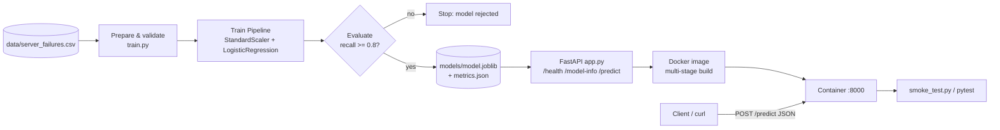

# Mini MLOps Project — Server Failure Prediction API

End-to-end: **dataset → preparation → training → evaluation → serialization → FastAPI → Docker → tests**.

## Architecture



## Files

| File | Purpose |
|---|---|
| `data/server_failures.csv` | dataset (400 rows, 5 features, label `failure`) |
| `train.py` | data prep, training, evaluation, quality gate, serialization |
| `app.py` | FastAPI prediction API |
| `test_app.py` | pytest API tests (in-process, no server needed) |
| `smoke_test.py` | tests a running service/container over HTTP |
| `Dockerfile` | multi-stage: train stage + slim runtime stage, non-root, healthcheck |
| `requirements*.txt` | pinned runtime / dev dependencies |
| `Makefile` | shortcuts: `make train test docker-build docker-run smoke` |

## Run it locally

```bash
python -m venv .venv && source .venv/bin/activate   # Windows: .venv\Scripts\activate
pip install -r requirements-dev.txt
python train.py                 # 1-5: data, prep, train, evaluate, serialize
pytest -q                       # 11: tests
uvicorn app:app --port 8000     # 6-7: API (docs at http://127.0.0.1:8000/docs)
```

```bash
curl -s -X POST http://127.0.0.1:8000/predict \
  -H "Content-Type: application/json" \
  -d '{"cpu_usage": 93, "memory_usage": 91, "disk_usage": 88, "error_count": 7, "response_time_ms": 650}'
# {"failure":true,"probability":0.9981,"threshold":0.3,"model_version":"1.0.0"}
```

## Run it in Docker

```bash
docker build -t server-failure-api:1.0.0 .                        # 9: build
docker run -d --name sfa -p 8000:8000 server-failure-api:1.0.0    # 10: run
docker ps --filter name=sfa                                       # STATUS shows (healthy)
BASE_URL=http://127.0.0.1:8000 python smoke_test.py               # 11: test
docker logs sfa && docker rm -f sfa
```

## Next steps
- Push the image to a registry (ECR/GHCR) from CI; deploy to Kubernetes with readiness/liveness probes on `/health`.
- Track experiments and models with MLflow; monitor prediction distributions for drift.
- See **Project 8** for the extended version with CI/CD.
