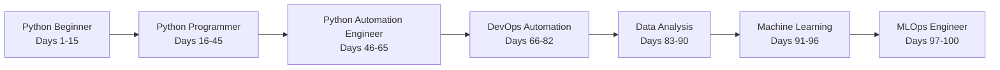
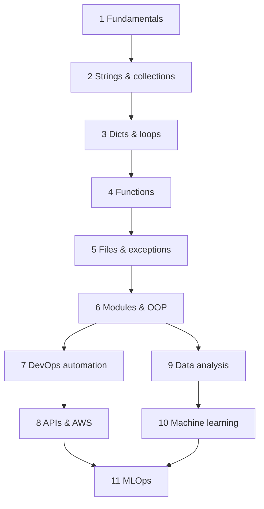

# 🗺 Roadmap — 100 Days of Python: From Beginner to DevOps and MLOps

[🏠 Back to README](README.md)

## The transformation

```text
Python Beginner
      ↓
Python Programmer
      ↓
Python Automation Engineer
      ↓
DevOps Automation
      ↓
Data Analysis
      ↓
Machine Learning
      ↓
MLOps Engineer
```



## Difficulty progression

| Phase | Topic | Days | Difficulty |
|---|---|---|---|
| 1 | Python Fundamentals | 1–15 | 🟢 Beginner |
| 2 | Strings and Collections | 16–25 | 🟢 Beginner |
| 3 | Dictionaries and Programming Logic | 26–35 | 🟢 Beginner |
| 4 | Functions and Modular Programming | 36–45 | 🟡 Beginner+ |
| 5 | File Handling and Error Handling | 46–55 | 🟡 Intermediate |
| 6 | Advanced Python and OOP | 56–65 | 🟡 Intermediate |
| 7 | Python for DevOps Automation | 66–75 | 🟠 Intermediate+ |
| 8 | API, Cloud and DevOps Integration | 76–82 | 🟠 Intermediate+ |
| 9 | Data Analysis and ML Preparation | 83–90 | 🟠 Intermediate+ |
| 10 | Machine Learning Fundamentals | 91–96 | 🔴 Advanced beginner (ML) |
| 11 | MLOps Foundation | 97–100 | 🔴 Advanced beginner (MLOps) |

## How the phases build on each other



## All 100 days

### Phase 1 — Python Fundamentals (Days 1–15)

**Difficulty:** 🟢 Beginner · **Folder:** [`01-python-fundamentals/`](01-python-fundamentals/README.md) · **Milestone:** Mini project: Server Resource Alert Calculator (Day 15)

| Day | Topic | Learning outcome |
|---|---|---|
| [001](01-python-fundamentals/day-001/README.md) | Introduction to Python, Installation, IDE, First Program | Explain what Python is and why DevOps and MLOps engineers use it |
| [002](01-python-fundamentals/day-002/README.md) | Variables and Naming Conventions | Create variables and assign values to them |
| [003](01-python-fundamentals/day-003/README.md) | Python Data Types | Name Python's core built-in data types |
| [004](01-python-fundamentals/day-004/README.md) | Python Literals | Recognise numeric, string, boolean, None and collection literals |
| [005](01-python-fundamentals/day-005/README.md) | Input and Output | Read user input with `input()` |
| [006](01-python-fundamentals/day-006/README.md) | Type Conversion | Convert between `str`, `int`, `float` and `bool` |
| [007](01-python-fundamentals/day-007/README.md) | Arithmetic Operators | Use `+ - * / // % **` correctly |
| [008](01-python-fundamentals/day-008/README.md) | Comparison Operators | Compare values with `== != > < >= <=` |
| [009](01-python-fundamentals/day-009/README.md) | Logical Operators | Combine conditions using `and`, `or`, `not` |
| [010](01-python-fundamentals/day-010/README.md) | Assignment Operators | Use compound assignment operators `+= -= *= /= //= %= **=` |
| [011](01-python-fundamentals/day-011/README.md) | Operator Precedence | Predict the order in which Python evaluates an expression |
| [012](01-python-fundamentals/day-012/README.md) | Conditional Statements (if) | Write an `if` statement that runs code only when a condition is True |
| [013](01-python-fundamentals/day-013/README.md) | if-else | Use `else` to handle the 'otherwise' case |
| [014](01-python-fundamentals/day-014/README.md) | elif and Nested Conditions | Check several conditions in order with `elif` |
| [015](01-python-fundamentals/day-015/README.md) | Python Fundamentals Revision and Mini Project | Revise variables, types, operators, input/output and conditions |

**Skills gained after this phase:** Install Python and run scripts; Variables, data types, literals; Input/output and type conversion; All operator families and precedence; Decision making with if / elif / else.

### Phase 2 — Strings and Collections (Days 16–25)

**Difficulty:** 🟢 Beginner · **Folder:** [`02-strings-collections/`](02-strings-collections/README.md) · **Milestone:** Project 1 — Student Information System (after Day 28)

| Day | Topic | Learning outcome |
|---|---|---|
| [016](02-strings-collections/day-016/README.md) | Strings Introduction | Create strings with single, double and triple quotes |
| [017](02-strings-collections/day-017/README.md) | String Indexing | Access individual characters using positive indexes |
| [018](02-strings-collections/day-018/README.md) | String Slicing | Extract substrings with `text[start:stop]` |
| [019](02-strings-collections/day-019/README.md) | String Methods | Use the most important string methods: `strip`, `lower/upper`, `replace`, `split`, `join` |
| [020](02-strings-collections/day-020/README.md) | String Formatting (f-strings) | Insert variables into text with f-strings |
| [021](02-strings-collections/day-021/README.md) | Lists | Create lists and understand that they are ordered and mutable |
| [022](02-strings-collections/day-022/README.md) | List Indexing and Slicing | Access list items by positive and negative index |
| [023](02-strings-collections/day-023/README.md) | List Methods | Use `append`, `extend`, `insert`, `pop`, `remove`, `clear` |
| [024](02-strings-collections/day-024/README.md) | Tuples | Create tuples and understand immutability |
| [025](02-strings-collections/day-025/README.md) | Sets and Set Operations | Create sets and remove duplicates |

**Skills gained after this phase:** String indexing, slicing and methods; f-string formatting; Lists, tuples and sets.

### Phase 3 — Dictionaries and Programming Logic (Days 26–35)

**Difficulty:** 🟢 Beginner · **Folder:** [`03-dictionaries-logic/`](03-dictionaries-logic/README.md) · **Milestone:** Mini project: Inventory Report Generator (Day 35)

| Day | Topic | Learning outcome |
|---|---|---|
| [026](03-dictionaries-logic/day-026/README.md) | Dictionaries | Create dictionaries of key → value pairs |
| [027](03-dictionaries-logic/day-027/README.md) | Dictionary Methods | Loop through dicts with `keys()`, `values()` and `items()` |
| [028](03-dictionaries-logic/day-028/README.md) | Nested Lists and Nested Dictionaries | Read and update data in nested lists and dictionaries |
| [029](03-dictionaries-logic/day-029/README.md) | For Loops | Repeat actions for every item in a collection with `for` |
| [030](03-dictionaries-logic/day-030/README.md) | While Loops | Repeat code while a condition is True |
| [031](03-dictionaries-logic/day-031/README.md) | Range Function | Generate number sequences with `range(stop)`, `range(start, stop)`, `range(start, stop, step)` |
| [032](03-dictionaries-logic/day-032/README.md) | Break, Continue, and Pass | Exit a loop early with `break` |
| [033](03-dictionaries-logic/day-033/README.md) | Nested Loops | Write loops inside loops |
| [034](03-dictionaries-logic/day-034/README.md) | List Comprehension | Build lists in one line with list comprehensions |
| [035](03-dictionaries-logic/day-035/README.md) | Programming Logic Practice and Mini Project | Combine loops, conditions, lists and dictionaries to solve problems |

**Skills gained after this phase:** Dictionaries and nested data; for / while loops, range, break/continue; List comprehensions.

### Phase 4 — Functions and Modular Programming (Days 36–45)

**Difficulty:** 🟡 Beginner+ · **Folder:** [`04-functions/`](04-functions/README.md) · **Milestone:** Project 2 — Python Calculator

| Day | Topic | Learning outcome |
|---|---|---|
| [036](04-functions/day-036/README.md) | Introduction to Functions | Explain why functions exist (reuse, readability, testing) |
| [037](04-functions/day-037/README.md) | Function Parameters and Arguments | Pass data into functions with parameters |
| [038](04-functions/day-038/README.md) | Return Statement | Send results back from a function with `return` |
| [039](04-functions/day-039/README.md) | Default Arguments | Give parameters default values |
| [040](04-functions/day-040/README.md) | Keyword Arguments | Call functions using `name=value` keyword arguments |
| [041](04-functions/day-041/README.md) | Variable-Length Arguments (*args) | Accept any number of positional arguments with `*args` |
| [042](04-functions/day-042/README.md) | Variable-Length Arguments (**kwargs) | Accept any number of keyword arguments with `**kwargs` |
| [043](04-functions/day-043/README.md) | Scope and Local/Global Variables | Explain local, enclosing, global and built-in scope (LEGB) |
| [044](04-functions/day-044/README.md) | Lambda Functions | Write small anonymous functions with `lambda` |
| [045](04-functions/day-045/README.md) | Functions Revision and Mini Project | Revise all function concepts from Days 36–44 |

**Skills gained after this phase:** Defining and calling functions; Parameters, defaults, *args, **kwargs; Scope and lambda functions.

### Phase 5 — File Handling and Error Handling (Days 46–55)

**Difficulty:** 🟡 Intermediate · **Folder:** [`05-files-exceptions/`](05-files-exceptions/README.md) · **Milestone:** Project 3 — Log File Analyzer

| Day | Topic | Learning outcome |
|---|---|---|
| [046](05-files-exceptions/day-046/README.md) | File Handling Introduction | Understand files, paths and file modes |
| [047](05-files-exceptions/day-047/README.md) | Reading Files | Read a whole file with `read()` |
| [048](05-files-exceptions/day-048/README.md) | Writing Files | Create and overwrite files with mode `"w"` |
| [049](05-files-exceptions/day-049/README.md) | Append Mode | Add data to the end of a file with mode `"a"` |
| [050](05-files-exceptions/day-050/README.md) | Working with CSV Files | Read CSV files with `csv.reader` and `csv.DictReader` |
| [051](05-files-exceptions/day-051/README.md) | Working with JSON | Convert between Python objects and JSON with `json.dumps/loads` |
| [052](05-files-exceptions/day-052/README.md) | Exception Handling | Understand what exceptions are and read tracebacks |
| [053](05-files-exceptions/day-053/README.md) | try, except, else, finally | Use `else` for code that runs only when no exception occurred |
| [054](05-files-exceptions/day-054/README.md) | Creating Custom Exceptions | Raise exceptions deliberately with `raise` |
| [055](05-files-exceptions/day-055/README.md) | File Processing Automation Project | Combine file handling, CSV/JSON and exceptions in one automation |

**Skills gained after this phase:** Read, write and append files; CSV and JSON processing; Exception handling and custom exceptions.

### Phase 6 — Advanced Python and OOP (Days 56–65)

**Difficulty:** 🟡 Intermediate · **Folder:** [`06-modules-oop/`](06-modules-oop/README.md) · **Milestone:** Project 4 — Linux System Health Checker (started)

| Day | Topic | Learning outcome |
|---|---|---|
| [056](06-modules-oop/day-056/README.md) | Modules and Imports | Import standard-library modules (`import`, `from ... import`, `as`) |
| [057](06-modules-oop/day-057/README.md) | Python Packages | Organise modules into a package with `__init__.py` |
| [058](06-modules-oop/day-058/README.md) | OS Module | Inspect and change the current working directory |
| [059](06-modules-oop/day-059/README.md) | Pathlib Module | Represent paths as `Path` objects |
| [060](06-modules-oop/day-060/README.md) | Shutil Module | Copy, move and delete files and directory trees |
| [061](06-modules-oop/day-061/README.md) | Subprocess Module | Run external commands with `subprocess.run` |
| [062](06-modules-oop/day-062/README.md) | Logging Module | Replace `print` with proper logging levels |
| [063](06-modules-oop/day-063/README.md) | Object-Oriented Programming Introduction | Explain classes, objects, attributes and methods in plain English |
| [064](06-modules-oop/day-064/README.md) | Classes, Objects, and Constructors | Initialise objects with the `__init__` constructor |
| [065](06-modules-oop/day-065/README.md) | Inheritance, Encapsulation, and Polymorphism | Create child classes that inherit and extend a parent class (`super()`) |

**Skills gained after this phase:** Modules and packages; os, pathlib, shutil, subprocess, logging; Classes, inheritance, encapsulation, polymorphism.

### Phase 7 — Python for DevOps Automation (Days 66–75)

**Difficulty:** 🟠 Intermediate+ · **Folder:** [`07-devops-automation/`](07-devops-automation/README.md) · **Milestone:** Project 4 — Linux System Health Checker

| Day | Topic | Learning outcome |
|---|---|---|
| [066](07-devops-automation/day-066/README.md) | Python System Administration Automation | Collect basic system facts with `platform`, `socket`, `getpass` and `os` |
| [067](07-devops-automation/day-067/README.md) | Working with Environment Variables | Read environment variables safely with defaults and type conversion |
| [068](07-devops-automation/day-068/README.md) | Command-Line Arguments using argparse | Build professional command-line interfaces with `argparse` |
| [069](07-devops-automation/day-069/README.md) | System Information and Resource Monitoring | Install and use `psutil` for cross-platform system metrics |
| [070](07-devops-automation/day-070/README.md) | Automating Files and Directories | Find files by age, size and pattern |
| [071](07-devops-automation/day-071/README.md) | Automating Linux Commands with subprocess | Chain commands and replace shell pipelines with Python |
| [072](07-devops-automation/day-072/README.md) | Regular Expressions | Write regex patterns with character classes, quantifiers, anchors and groups |
| [073](07-devops-automation/day-073/README.md) | Python Automation for Log Analysis | Parse a real-looking application log with regex into structured records |
| [074](07-devops-automation/day-074/README.md) | Python Script for Server Health Monitoring | Combine psutil metrics, thresholds and HTTP/port checks into one health script |
| [075](07-devops-automation/day-075/README.md) | DevOps Automation Project | Build a complete **server monitoring tool** from everything learned in Phases 1–7 |

**Skills gained after this phase:** Environment variables and argparse CLIs; psutil monitoring and subprocess automation; Regex-based log analysis.

### Phase 8 — API, Cloud and DevOps Integration (Days 76–82)

**Difficulty:** 🟠 Intermediate+ · **Folder:** [`08-api-cloud/`](08-api-cloud/README.md) · **Milestone:** Project 5 — AWS Automation Script

| Day | Topic | Learning outcome |
|---|---|---|
| [076](08-api-cloud/day-076/README.md) | HTTP and HTTPS Fundamentals | Explain how an HTTP request/response works (methods, URLs, headers, body, status codes) |
| [077](08-api-cloud/day-077/README.md) | REST API Concepts | Explain REST resources, endpoints and how HTTP methods map to CRUD |
| [078](08-api-cloud/day-078/README.md) | Working with APIs using Requests | Install and use the `requests` library for HTTP calls |
| [079](08-api-cloud/day-079/README.md) | GET and POST Requests | Send query parameters, JSON bodies, form data and custom headers |
| [080](08-api-cloud/day-080/README.md) | API Authentication and Tokens | Use API keys, Basic auth and Bearer tokens correctly |
| [081](08-api-cloud/day-081/README.md) | YAML and Configuration Files | Read and write YAML with PyYAML (`safe_load`, `safe_dump`) |
| [082](08-api-cloud/day-082/README.md) | Boto3 Introduction and AWS SDK | Install boto3 and understand clients, resources, sessions and the credential chain |

**Skills gained after this phase:** HTTP, REST and the requests library; Token authentication and YAML config; AWS automation with boto3.

### Phase 9 — Data Analysis and ML Preparation (Days 83–90)

**Difficulty:** 🟠 Intermediate+ · **Folder:** [`09-data-analysis/`](09-data-analysis/README.md) · **Milestone:** Project 6 — CSV Data Analysis

| Day | Topic | Learning outcome |
|---|---|---|
| [083](09-data-analysis/day-083/README.md) | Introduction to Data Science and Data Analysis | Explain the data analysis workflow: question → collect → clean → explore → visualise → communicate |
| [084](09-data-analysis/day-084/README.md) | NumPy Introduction | Explain why NumPy arrays are faster and more convenient than lists for numbers |
| [085](09-data-analysis/day-085/README.md) | NumPy Arrays and Operations | Index, slice and filter arrays with boolean masks |
| [086](09-data-analysis/day-086/README.md) | Pandas Introduction | Explain what pandas is and how it relates to NumPy, Excel and SQL |
| [087](09-data-analysis/day-087/README.md) | Pandas Series and DataFrames | Create Series and DataFrames from lists and dictionaries |
| [088](09-data-analysis/day-088/README.md) | Reading CSV and Excel Data | Use `read_csv` options: separators, columns, dtypes, dates, missing values, chunks |
| [089](09-data-analysis/day-089/README.md) | Data Filtering, Sorting, and Grouping | Filter rows with boolean conditions, `isin`, `between`, string methods and `query` |
| [090](09-data-analysis/day-090/README.md) | Data Cleaning and Handling Missing Values | Detect missing values, duplicates, wrong types and inconsistent text |

**Skills gained after this phase:** NumPy arrays and vectorised maths; Pandas Series/DataFrames; Filtering, grouping and cleaning data.

### Phase 10 — Machine Learning Fundamentals (Days 91–96)

**Difficulty:** 🔴 Advanced beginner (ML) · **Folder:** [`10-machine-learning/`](10-machine-learning/README.md) · **Milestone:** Project 7 — ML Prediction Project

| Day | Topic | Learning outcome |
|---|---|---|
| [091](10-machine-learning/day-091/README.md) | AI vs ML vs Deep Learning | Explain the difference between Artificial Intelligence, Machine Learning and Deep Learning |
| [092](10-machine-learning/day-092/README.md) | Supervised vs Unsupervised Learning | Distinguish supervised (labelled) and unsupervised (unlabelled) learning |
| [093](10-machine-learning/day-093/README.md) | Features, Labels, Training Data, and Testing Data | Identify features (X) and labels (y) in a dataset |
| [094](10-machine-learning/day-094/README.md) | Introduction to Scikit-Learn | Use scikit-learn's consistent estimator API: `fit`, `predict`, `score`, `transform` |
| [095](10-machine-learning/day-095/README.md) | Linear Regression | Understand linear regression: coefficients, intercept and the line of best fit |
| [096](10-machine-learning/day-096/README.md) | Classification and Model Evaluation | Train classifiers (logistic regression, random forest) to predict server failures |

**Skills gained after this phase:** ML vocabulary: features, labels, train/test; scikit-learn workflow; Regression, classification and evaluation.

### Phase 11 — MLOps Foundation (Days 97–100)

**Difficulty:** 🔴 Advanced beginner (MLOps) · **Folder:** [`11-mlops/`](11-mlops/README.md) · **Milestone:** Project 8 — End-to-End MLOps Deployment

| Day | Topic | Learning outcome |
|---|---|---|
| [097](11-mlops/day-097/README.md) | Saving and Loading ML Models using Pickle/Joblib | Serialize trained models with `pickle` and `joblib` and load them back |
| [098](11-mlops/day-098/README.md) | Building an ML API using FastAPI | Build a REST API with FastAPI: routes, path/query parameters and JSON bodies |
| [099](11-mlops/day-099/README.md) | Dockerizing an ML Application | Write a production-style Dockerfile for a Python ML API (slim base, non-root, healthcheck) |
| [100](11-mlops/day-100/README.md) | End-to-End Mini MLOps Project | Deliver a complete ML system: data → prep → train → evaluate → serialize → API → Docker → tests |

**Skills gained after this phase:** Model serialization with joblib; Serving models with FastAPI; Docker packaging and an end-to-end pipeline.


## Projects

| # | Project | When |
|---|---|---|
| 1 | [Student Information System](projects/01-student-information-system/README.md) | after Day 28 |
| 2 | [Python Calculator](projects/02-python-calculator/README.md) | after Day 53 |
| 3 | [Log File Analyzer](projects/03-log-file-analyzer/README.md) | after Day 55 |
| 4 | [Linux System Health Checker](projects/04-linux-system-health-checker/README.md) | after Day 75 |
| 5 | [AWS Automation Script](projects/05-aws-automation-script/README.md) | after Day 82 |
| 6 | [CSV Data Analysis](projects/06-csv-data-analysis/README.md) | after Day 90 |
| 7 | [Machine Learning Prediction Project](projects/07-ml-prediction-project/README.md) | after Day 96 |
| 8 | [End-to-End MLOps Deployment](projects/08-end-to-end-mlops-deployment/README.md) | after Day 100 |

## Weekly rhythm (suggested)

| Day of week | Activity |
|---|---|
| Mon–Fri | one lesson per day (60–90 min) |
| Saturday | catch-up + extend a task or project |
| Sunday | rest, or write a short LinkedIn/blog post about what you learned |

At this rhythm the course takes ~20 weeks; at one lesson every day, 100 days.

## 🚀 What to learn next

After Day 100 you have the foundations. Recommended next steps for an MLOps engineer:

1. **Testing & quality:** pytest fixtures/mocking, type hints + mypy, Ruff, pre-commit hooks.
2. **Experiment tracking & registry:** MLflow (tracking server, model registry, stages).
3. **Data & pipeline versioning:** DVC, Great Expectations / pandera for data validation.
4. **Orchestration:** Airflow, Prefect or Kubeflow/Argo Workflows for scheduled training pipelines.
5. **Serving at scale:** KServe/Seldon on Kubernetes, BentoML, SageMaker endpoints, autoscaling, canary releases.
6. **Monitoring:** Prometheus + Grafana for service metrics; Evidently/WhyLabs for data & model drift.
7. **Deep learning & LLMOps:** PyTorch basics, Hugging Face, serving LLMs (vLLM), prompt/RAG evaluation.
8. **Certifications (optional):** AWS Certified Machine Learning Engineer – Associate, Google Professional ML Engineer.
