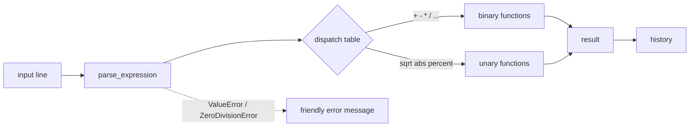

# Project 2 — Python Calculator

**Phase:** after Day 45 (uses Day 52–53 exception handling) · **Difficulty:** 🟡 Beginner+ · **Concepts:** functions, operators, conditions, exception handling

An interactive command-line calculator with a dispatch table, input validation, history and clear error messages — plus unit tests.

## Features
- Binary operations: `+ - * / // % **`
- Unary functions: `sqrt 16`, `abs -4`, `percent 20 of 150`
- `history` shows previous results; `ans` reuses the last result (`ans * 2`)
- Friendly errors for bad numbers, unknown operators and division by zero — the program never crashes
- Pure functions in `calculator.py`, interactive shell in `main()`, tests in `test_calculator.py`

## Run it
```bash
python calculator.py
```
```text
Python Calculator - type 'help' for commands, 'quit' to exit
calc> 12 * 7
= 84
calc> ans / 4
= 21
calc> 5 / 0
Error: division by zero
calc> sqrt 2
= 1.4142135624
calc> percent 15 of 240
= 36
calc> history
1. 12 * 7 = 84
2. ans / 4 = 21
...
```

## Tests
```bash
pip install pytest
pytest -q
```

## Design


## Extend it
1. Add `log` and `sin/cos` using the `math` module.
2. Support expressions with more than two operands (hint: research the shunting-yard algorithm, or Python's `ast` module — never `eval()` on user input!).
3. Save history to a file between sessions (Day 49).
