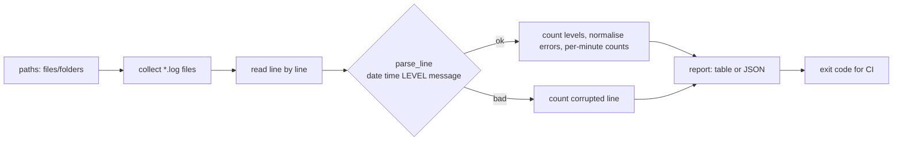

# Project 3 — Log File Analyzer

**Phase:** after Day 55 (enhanced with Day 72–73 regex) · **Difficulty:** 🟡 Intermediate · **Concepts:** file handling, strings, loops, dictionaries, exceptions

A command-line tool that analyses application log files and counts **INFO**, **WARNING** and **ERROR** messages — per file and overall — and reports top errors, busiest minutes and corrupted lines.

## Features
- Accepts one or more files **or folders** (`*.log` inside folders)
- Counts INFO / WARNING / ERROR (and reports unknown/corrupted lines instead of crashing)
- Top error messages (numbers normalised so similar errors group together)
- Errors per minute and the busiest minute
- Output as a text table, or JSON (`--json`) for other tools
- `--fail-on-errors N` exit code for CI/cron alerting
- Handles missing files, permission problems and non-UTF-8 bytes gracefully

## Usage
```bash
python log_analyzer.py sample_logs/                        # analyse a folder
python log_analyzer.py ../../datasets/app.log --top 5      # one file, top 5 errors
python log_analyzer.py sample_logs/ --json > report.json   # machine-readable
python log_analyzer.py sample_logs/ --fail-on-errors 3 ; echo $?   # 1 if >= 3 errors
```

Example output:
```text
FILE             LINES   INFO  WARNING  ERROR  BAD
api.log              8      4        2      2    0
worker.log           7      3        1      2    1
TOTAL               15      7        3      4    1

Error rate: 28.6% of valid lines
Top errors:
  2 x Database connection timeout after <N>ms
  ...
```

## Tests
```bash
pip install pytest && pytest -q
```

## How it works

