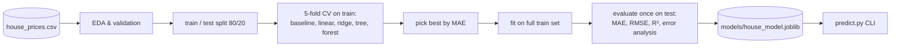

# Project 7 — Machine Learning Prediction Project

**Phase:** after Day 96 · **Difficulty:** 🔴 Advanced beginner · **Concepts:** pandas, scikit-learn, train/test split, cross-validation, regression metrics, model selection, serialization

**Goal:** predict house prices from size, bedrooms, age and distance to the city centre — and build it the way a professional would: baseline first, several models compared with cross-validation, final evaluation on a held-out test set, error analysis, saved model, and a prediction CLI.

## Workflow


## Run
```bash
pip install pandas scikit-learn joblib matplotlib
python train_model.py                       # trains, compares, evaluates, saves
python predict.py --size 1800 --bedrooms 3 --age 5 --distance 8
python predict.py --csv new_houses.csv      # batch predictions
```

Sample training output:
```text
Dataset: 200 rows, 4 features, price range 44,400 - 628,200
Cross-validation (5-fold MAE on training data, lower is better):
  baseline_mean           120,095
  linear_regression        14,621
  ridge                    14,604
  decision_tree            28,084
  random_forest            22,061
Best model: ridge
Test set -> MAE 15,220 | RMSE 19,900 | R² 0.9832
Mean absolute error by bedrooms: {1: 8240.0, 2: 28200.0, 3: 13850.0, ...}
Saved models/house_model.joblib
```

## What you practise
| Step | Skill |
|---|---|
| Baseline | always know what "no model" scores (`DummyRegressor`) |
| Cross-validation | fair comparison without touching the test set |
| Pipelines | scaling inside the model object → no leakage |
| Error analysis | where is the model wrong? (by bedroom count) |
| Serialization | bundle with features, metrics, versions |
| CLI | argparse for single and batch predictions |

## Extensions
- Add the server-failure **classification** problem with the same structure (precision/recall instead of MAE).
- Hyper-parameter tuning with `GridSearchCV`.
- Serve the model with FastAPI (see Project 8).
