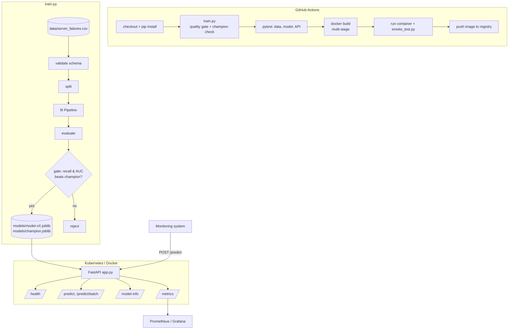

# Project 8 — End-to-End MLOps Deployment

**Phase:** capstone after Day 100 · **Difficulty:** 🔴 Advanced beginner (MLOps) · **Concepts:** Python, pandas, scikit-learn, FastAPI, Docker, API testing, CI/CD, Kubernetes

This project extends the [Day 100 mini project](../../11-mlops/day-100/mini-mlops/README.md) into a production-shaped ML service:

| Added in Project 8 | Why it matters |
|---|---|
| `config.yaml` drives training (features, model params, thresholds, gates) | change experiments without code changes |
| Versioned model artefacts + **champion/challenger** promotion | never replace a better production model with a worse one |
| Prometheus-style `/metrics` endpoint | observability: request counts, latency, prediction rate |
| `tests/` for training logic **and** the API | CI catches data, model and API regressions |
| `docker-compose.yml` | one-command local stack |
| `k8s/` manifests with probes and resources | deploy to any Kubernetes cluster |
| GitHub Actions workflow ([`/.github/workflows/project8-mlops.yml`](../../.github/workflows/project8-mlops.yml)) | train → test → build → smoke-test on every push |

## Architecture



## Quick start
```bash
cd projects/08-end-to-end-mlops-deployment
python -m venv .venv && source .venv/bin/activate
pip install -r requirements-dev.txt
make train        # python train.py --config config.yaml
make test         # pytest -q
make run          # uvicorn app:app --port 8000   -> http://127.0.0.1:8000/docs
```

## Docker
```bash
make docker-build                       # docker build -t server-failure-api:2.0.0 .
make docker-run                         # docker run -p 8000:8000 ...
make smoke                              # BASE_URL=http://127.0.0.1:8000 python smoke_test.py
docker compose up -d --build            # or the compose stack
```

## Kubernetes
```bash
kind create cluster --name mlops        # or minikube / EKS
kind load docker-image server-failure-api:2.0.0 --name mlops
kubectl apply -f k8s/
kubectl rollout status deployment/server-failure-api
kubectl port-forward svc/server-failure-api 8000:80
```

## API
| Method | Path | Description |
|---|---|---|
| GET | `/health` | liveness/readiness (model loaded?) |
| GET | `/model-info` | version, metrics, features, training time |
| POST | `/predict` | one prediction |
| POST | `/predict/batch` | up to 1000 predictions |
| GET | `/metrics` | Prometheus text format counters |

```bash
curl -s -X POST localhost:8000/predict -H 'Content-Type: application/json' \
  -d '{"cpu_usage":93,"memory_usage":91,"disk_usage":88,"error_count":7,"response_time_ms":650}'
```

## Champion / challenger
`train.py` saves every model as `models/model-v<version>.joblib`. It is promoted to `models/champion.joblib` (what the API serves) only if it passes the quality gates in `config.yaml` **and** its ROC AUC is not worse than the current champion's.

Try it: run `python train.py` (logistic regression v2.0.0 becomes champion, AUC ≈ 0.98). Then edit `config.yaml` → `type: random_forest`, `version: "2.1.0"` and run again: the forest passes the gates but has a lower AUC (≈ 0.95), so you'll see `[promote] kept champion v2.0.0`.

## What to learn next
MLflow (tracking + registry), DVC (data versioning), Evidently (drift monitoring), KServe/Seldon (model serving on K8s), Argo Workflows/Kubeflow Pipelines.
